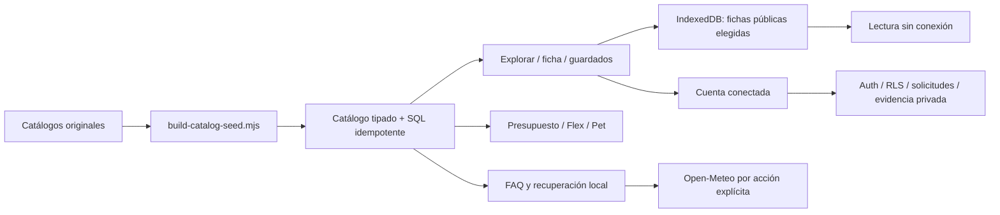

# Arquitectura de CHULLA VIDA 3.0

La SPA existente se mantiene en React/TypeScript/Vite. `src/App.tsx` compone el contexto demo anterior, consentimiento y catálogo V3. Las cuentas conectadas son independientes del selector de perfil demo.

## Módulos

| Ruta | Responsabilidad |
| --- | --- |
| `src/domain/catalog` | Modelo normalizado, 33 fichas, filtros y precios en moneda original |
| `src/domain/culture` | Referencias culturales y estado de ediciones |
| `src/domain/planner` | Presupuesto, restricciones, alternativas y mascotas |
| `src/domain/weather` | Validación/consulta/normalización del pronóstico y búsqueda de localidades |
| `src/domain/legal`, `consent` | Estado de borradores y preferencias separadas |
| `src/features/catalog`, `workspace` | Interfaz pública y coordinación de paneles |
| `src/features/auth` | Cuenta y flujos sujetos a RLS |
| `src/features/assistant` | MIJIN local, voz opcional, referencias y clima |
| `src/features/offline` | Biblioteca pública validada y preparación del shell |
| `api` | Adaptadores Vercel opcionales; jamás claves de servidor en el cliente |
| `supabase` | Esquema, políticas, semillas y pruebas locales de permisos |

## Separación de estados

Los datos del prototipo siguen en claves `chullavida:v1:*`. Los guardados V3 usan `catalog-saved`; las fichas descargadas, IndexedDB independiente. No se convierten reservas, cobros ni sellos de prueba en transacciones de Supabase. Los modelos de precio y estados originales no se reducen al antiguo `Place`.

Offline consulta instantáneas elegidas, con versión y fecha. El service worker no intercepta `/api`, Auth, requests con autorización ni dominios externos. Las acciones transaccionales necesitan conexión y permisos del servidor.

## Decisiones

- Mantener Vite y el logo aportado; reutilizar CSS e ilustraciones regionales.
- Aislar el prototipo para conservar pruebas y datos locales existentes.
- No convertir EUR ni completar costes o disponibilidad desconocidos.
- Preparar Supabase sin fingir una conexión inexistente.
- Fuentes locales como evidencia editorial; la fecha de importación no certifica vigencia externa.
